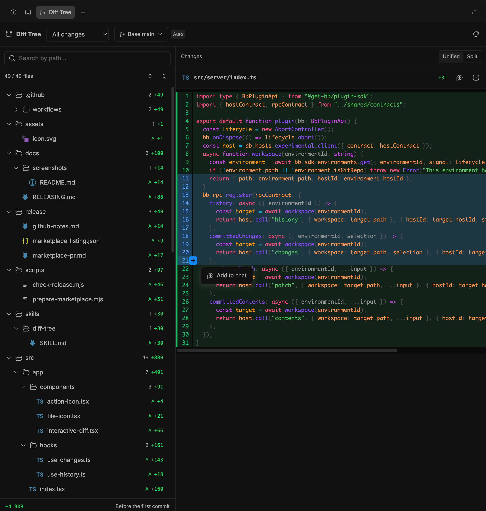

# Diff Tree for BB

Review Git changes by folder, compare commits, and bring selected code into your BB chat.

Diff Tree adds a thread panel to [BB](https://getbb.app) with a searchable file tree beside an interactive diff. Keep track of changes across large directories, inspect the last commit or a group of commits, and quote the lines you want to discuss with your agent.



## What you get

- **A directory tree for changes.** Collapse folders, search current and previous paths, and see file statuses and aggregate additions/deletions.
- **Four comparison scopes.** Review all branch changes, the working copy, the last 1–100 commits, or one selected commit.
- **Searchable comparison branches.** Use BB's branch picker with an automatic default based on the recorded creation branch when available.
- **Unified and split diffs.** Syntax highlighting follows BB's code theme. Expand unchanged lines upwards or downwards in configurable steps (30 lines by default), or reveal an entire gap.
- **Code in your chat draft.** Click a line number, Shift-click to extend, or drag across line numbers; then choose **Add to chat**. Quotes include the path, line coordinates, and comparison revision.
- **File mentions.** Use the button beside the filename or Cmd/Ctrl+click a tree file. Both append a workspace mention without sending the message.
- **File type icons.** [Seti UI](https://github.com/jesseweed/seti-ui) supplies 148 SVG icons with rules for 287 extensions and special filenames, bundled for offline use.

## Requirements

- BB **0.46.1+** with Plugin SDK **0.6.49+**.
- A Git workspace associated with the current BB thread.
- Git on the workspace's host for commit history and committed comparisons.

There are no API keys, external services, or separate accounts to configure. The UI is in English. Remote workspaces use the environment's enrolled BB host.

## Install

For a local checkout:

```sh
npm ci --ignore-scripts
bb plugin build .
bb plugin install .
```

BB asks you to approve the local source. Open **Diff Tree** with the branch icon in a thread header, or choose **+ → Diff Tree** in its right panel.

Install the tagged release from [SergeyGavrilov/bb-diff-tree](https://github.com/SergeyGavrilov/bb-diff-tree):

```sh
bb plugin install 'git:https://github.com/SergeyGavrilov/bb-diff-tree.git@^0.1.0'
```

Git installs build the plugin through BB; Node and npm are only needed when developing it yourself.

## Review changes

| Scope | What it shows |
| --- | --- |
| **All changes** | The branch and working copy relative to the selected comparison branch. Before the first commit, shows staged, unstaged, and untracked files. |
| **Uncommitted** | Staged, unstaged, and untracked changes together. |
| **Recent commits** | One combined diff of the last 1–100 first-parent commits, excluding working-copy changes. Set **Last 1 commit** or **Last 2 commits** for those ranges. |
| **Single commit** | The chosen commit against its first parent. The picker lists up to 200 recent first-parent commits by SHA, subject, and author. |

**Base** applies immediately. The Auto badge explains where its default came from; a manual choice can be reset. Automatic selection prefers the creation branch recorded by BB, then the configured comparison, then the repository default. Git does not reliably retain a parent branch's name, so branches created outside BB may require manual selection.

The sidebar resizes horizontally in wide panels and moves above the diff in narrow panels. Search temporarily expands matching folders. Refresh manually or return to the app to update changes; selection, search, and collapsed folders survive refresh.

### Shortcuts and chat

| Action | Gesture |
| --- | --- |
| Select a file | Click its tree row |
| Add a file mention to the draft | Cmd/Ctrl+click its tree row, or the chat button beside the filename |
| Select a diff line | Click its line number |
| Extend the selection | Shift-click another line number, or drag across line numbers |
| Dismiss a line selection | Escape or click outside the diff |
| Navigate tree rows | ↑ / ↓, Home / End |
| Expand or collapse a folder | → / ←, or click the folder |

Chat actions append to the existing draft and focus the composer. They never submit it. Historical diff quotes identify the selected revisions; **Open working-copy file** opens the current workspace file.

## Settings (unreleased)

The development checkout adds settings under **Settings → Diff Tree** (also available on the installed plugin's detail page). These changes are not included in the published v0.1.0 release. BB saves the preferences and applies them without a plugin reload.

- **File links in chat:** keep **BB default**, **Show a Diff Tree button beside links**, or **Open in Diff Tree** on ordinary clicks. BB default is the initial setting.
- **Show file type icons:** enabled by default; disabling it hides file icons in both the tree and filename header.
- **Smooth diff transitions:** enabled by default. Replace visible loading text with a quiet skeleton and fade the ready diff in over 160 ms, without delaying data display. Disable to restore loading text and immediate transitions. The system's reduced-motion preference disables the animations.
- **Default diff layout:** Unified or Split. The toolbar still allows a temporary override in an open viewer.
- **Code font size:** 10–24 px, default 12.
- **Unchanged lines per expansion:** 1–200, default 30. Expand all remains available.
- **Refresh when returning to BB:** enabled by default. Manual refresh is always available.

Chat routing applies to live workspace `file:` links and the **Open** buttons in GenUI's **Changes** cards (including file lists inside **Commits**). In button mode, an additional Diff Tree icon appears beside the existing open button; in direct mode, the existing open button opens Diff Tree. Clicking the filename keeps expanding the card's inline diff. Routing selects the file in the thread's Diff Tree panel, clears the path filter, expands its parent folders, and switches to All changes while keeping the chosen comparison branch. Successive links reuse the same panel tab. A file absent from the comparison gets an explicit notice and an **Open file in BB** link.

Modified clicks, context menus, web links, files outside the workspace, and links in plugin/file previews retain BB behavior. If the panel cannot open, the original link remains usable. Line suffixes identify the file; navigation does not currently jump to a particular line.

BB 0.46.1 has no public file-link interception slot. The optional routing uses a cleanup-safe content script over rendered chat anchors, GenUI's accessible file-row controls, and pane containers, with SDK navigation from the owning thread header. It does not read private React state. These DOM adapters may need adjustment when BB or GenUI changes its markup; the default setting leaves links untouched.

## Limits and data access

Diff Tree is a separate panel. It does not replace BB's built-in Changes panel and does not stage, revert, or write commits.

Workspace metadata and branch/working-copy diffs use the public BB SDK. Committed comparisons run bounded, read-only Git commands on the environment's host through typed RPC. The server resolves the host and workspace from the environment ID; the frontend cannot supply an arbitrary host path. Commands run without a shell, optional Git locks, external diff drivers, text converters, or network Git operations.

Historical patches and context are pinned to object IDs. Full versions must match the patch before unchanged lines can expand; refresh if the working copy changes during loading. Context is limited to **512 KiB per version**. Binary files, large files, unavailable context, and truncated results show notices while supported patches remain readable.

Commit history is limited to 200 entries, recent ranges to 100 commits, a committed file list to 10,000 files, and Git command output to 4 MiB. Line quotes contain at most 500 diff rows. Preferences are stored by BB; chat navigation targets are kept only for the current app session. The plugin adds no telemetry, background polling, or external icon requests.

## Development

Use Node **22.19+** or **24+**, npm, and the BB CLI. The SDK and Pierre declarations are pinned to the versions supplied by the supported BB runtime.

```sh
npm ci --ignore-scripts
npm run check
npm run build
npm run check:release
bb plugin reload diff-tree
```

For a live build loop, use `bb plugin dev .` after installing the path plugin. Run `bb plugin types --check .` to compare SDK declarations with your running BB.

```text
src/
  app/        React panel, components, hooks, and theme-aware styles
  core/       Tree construction, comparison defaults, diff context, and quoting
  host/       Read-only Git history and committed snapshot operations
  server/     Environment resolution and frontend-to-host RPC routing
  shared/     RPC contracts and plugin settings
tests/       Panel interactions, core behavior, real Git fixtures, and helpers
assets/      Plugin branding
skills/      Instructions exposed to BB agents
scripts/     Release package validation and marketplace preparation
release/     Listing metadata and draft release/PR text
docs/        Contribution, release, and screenshot guidance
```

The tests exercise the real Pierre renderer and its selection/expansion interactions under jsdom; only browser APIs unavailable in jsdom are stubbed. Git tests use temporary repositories. Run the installed plugin in BB to check layout, themes, and host integration before release.

See [CONTRIBUTING.md](CONTRIBUTING.md) and [docs/RELEASING.md](docs/RELEASING.md) for checks and publishing steps.

## License

[MIT](LICENSE). Third-party icon attribution is in [THIRD_PARTY_NOTICES.md](THIRD_PARTY_NOTICES.md).
